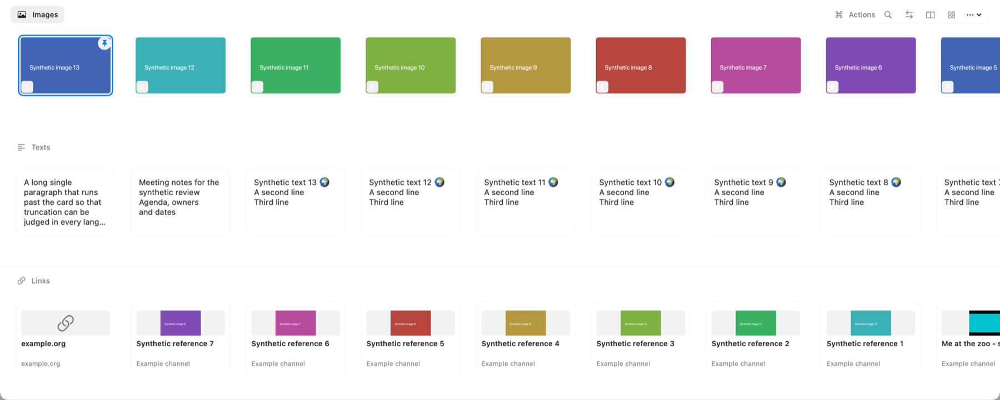
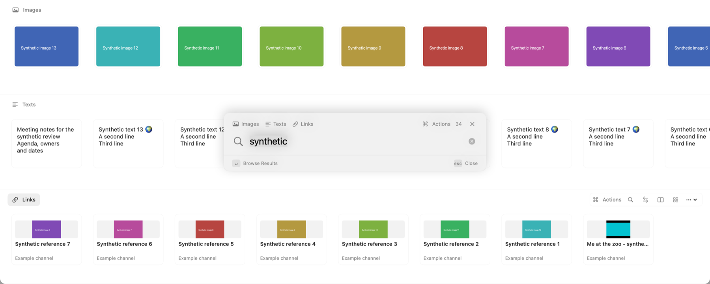
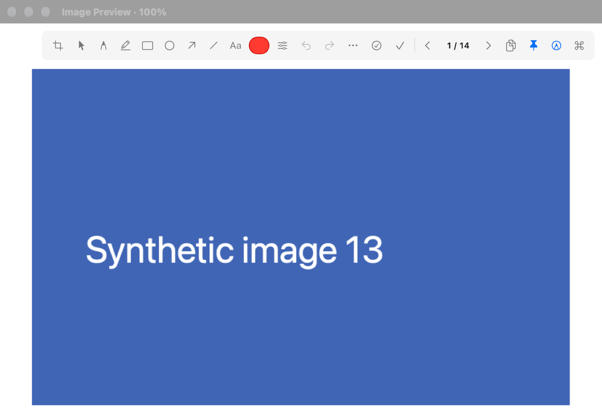

<p align="center">
  
</p>

<h1 align="center">Shelf</h1>

<p align="center"><strong>Clipboard history for macOS, kept on your Mac.</strong></p>

<p align="center">macOS 14 or later · Nine languages</p>

Shelf lives in the menu bar and remembers the images, text and links you copy. Press a shortcut to bring your recent copies back, then paste one, drag it into another app or keep it in your Library with pins, folders and tags.



## What it does

**Find anything you copied.** Images, text and links each get their own shelf. Search looks through copied text, page titles, tags, links and the text inside images.



**Keep what matters.** Pin items, file them in folders and tag them. Notes can be edited, and images can be cropped or annotated; Shelf always keeps the original.

<p align="center">
  
</p>

**Stay in control.**

- Every kind of capture is off until you turn it on.
- Pause capture for 5 minutes, an hour or until you resume, or skip just the next copy.
- Never capture copies from apps you choose, such as a password manager.
- See which app each item came from, and filter by it.
- Removed items wait in Library Trash for 30 days by default, so a mistake can be undone.

**Work from the keyboard.** Every action has a shortcut, and **Command + K** opens a searchable list of all of them.

| Action | Shortcut |
| --- | --- |
| Show shelves | Control + Option + T |
| Preview the selected item | Space |
| Copy and return to your previous app | Return |
| Pin an item | P |
| File an item in a folder | Shift + P |
| Undo the last removal | Backspace |
| Open Actions | Command + K |

Shortcuts can be changed in Settings. Pasting directly into another app needs the macOS Accessibility permission; ordinary copying does not.

## Install

You need **macOS 14 or later**, Xcode with the macOS SDK, and Python 3.

```sh
git clone https://github.com/baypeanut/shelf.git
cd shelf
bash scripts/build-community.sh release
open build/Shelf.app
```

The app is built at `build/Shelf.app` and checked with an isolated test launch before the script finishes. Move it to your Applications folder to keep it.

To add offline visual search, which finds images by what they show, include the search model. The first build downloads pinned model files; search then runs entirely on your Mac.

```sh
SHELF_BUNDLE_MODELS=1 bash scripts/build-community.sh release
```

> [!NOTE]
> This is a local build signed only for your Mac. It is not notarized and does not update itself; to update, pull the latest changes and build again.

## First launch

1. Open **Settings → Sources** and choose what Shelf should capture: images, text, links or any mix. All three start off.
2. Optionally turn on link previews. They have their own switch, because loading a preview contacts the copied website.
3. Press **Control + Option + T** to open your shelves.

Shelf can also collect screenshots. It watches your current screenshot folder, plus any folders you add. **Inbox mode** sends new screenshots straight to Shelf; it asks before changing where macOS saves them, and puts the setting back when you turn it off or quit.

## Privacy

Shelf has no account, cloud sync, analytics or online services. Your Library stays in `~/Library/Application Support/Shelf/`.

- Copies that password managers and other apps mark as confidential, concealed or transient are skipped.
- Shelf notes which app each copy came from and keeps that on your Mac.
- Secrets that are not marked cannot always be recognized, so pause capture or ignore an app when you need to.
- Your history is protected by your macOS account and is not encrypted by Shelf.
- Link previews are off by default. When on, the website can see the request and your IP address.

See [Privacy](PRIVACY.md) and [Security](SECURITY.md) for the full details.

## Guides

| Using Shelf | Working on Shelf |
| --- | --- |
| [Getting started](docs/user-guide.md) | [Building from source](docs/build-guide.md) |
| [Library](docs/library-guide.md) | [Testing changes](docs/testing-guide.md) |
| [Previews and editing](docs/preview-guide.md) | [Design notes](docs/design.md) |
| [Keyboard shortcuts](docs/keyboard-guide.md) | [Contributing](CONTRIBUTING.md) |
| [Troubleshooting](docs/troubleshooting.md) | [Dependencies](DEPENDENCIES.md) |

## Development

Shelf is written in Swift with AppKit, SwiftUI, Vision, Core ML and SQLite. App code is in `Sources/Shelf`, tests in `Tests` and build tools in `scripts`.

```sh
swift test
bash scripts/build-community.sh release
python3 scripts/verify-bundle.py build/Shelf.app
```

To look at the interface with sample content and separate preferences, run `bash scripts/build-ui-tests.sh` and open `build/Shelf UI Test.app`. The [testing guide](docs/testing-guide.md) lists every check to run before a change.

## License

Copyright © 2026 baypeanut. All rights reserved. See [LICENSE](LICENSE).
